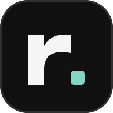
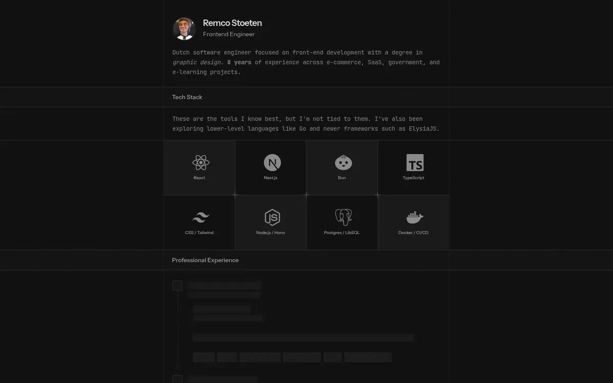

<p align="center">
  
</p>

<h1 align="center">remcostoeten.nl</h1>

<p align="center">Source for <a href="https://remcostoeten.nl">remcostoeten.nl</a>, the personal website, blog and toolbox of Remco Stoeten.</p>

<p align="center">
  
  
  
  
  
</p>

<p align="center">
  
</p>
<p align="center">
  <sub>Recorded on a local dev server of this branch at 1440×900.</sub>
</p>

The site is a Next.js App Router application. Public pages are prerendered, activity data such as GitHub commits and Spotify playback is read from Postgres and refreshed by a daily cron, and a signed-in admin area edits the content behind the public pages.

- **Blog** written as markdown files in the repo, with topics, drafts, RSS, callouts, syntax highlighting, reactions and comments.
- **Activity feed** showing recent GitHub commits and current Spotify listening on the homepage.
- **Browser tools** at `/tools`: diff checker, JSON formatter, SVG and HEIC converters, link extractor, find and replace, and a few map utilities.
- **Package pages** at `/packages` documenting the open-source React packages published under `@remcostoeten`.
- **Admin area** behind GitHub or Google sign-in for the intro, experience, projects, blog, contact submissions and analytics.
- **Contact form** backed by server actions and stored in Postgres.
- **SEO** handled per route: generated Open Graph images, sitemap, robots, manifest and canonical URLs.

## Development

Node 24 and Bun 1.3 are required, plus a Postgres connection string. Neon works out of the box.

```bash
bun install                 # install dependencies
cp .env.example .env.local  # then fill in DATABASE_URL, BETTER_AUTH_URL and BETTER_AUTH_SECRET
bun run db:push             # push the Drizzle schema to the database
bun run dev                 # start the dev server on http://localhost:3000
bun run check               # oxlint, tsgo typecheck and vitest
```

Every other variable in `.env.example` enables one integration (GitHub, Google, Spotify, YouTube Music, PostHog, ipinfo). A missing one disables its feature instead of breaking the build. The GitHub and Google OAuth apps can be created with [oauth-app-automator](https://github.com/remcostoeten/oauth-app-automator).

Server code lives under `src/server`, route handlers stay thin and delegate to it, and blog posts are read from `src/app/(marketing)/blog/posts` and enriched with topic and reading time at build.

<br/>

xxx,<br/>
[Remco Stoeten](https://remcostoeten.com)<br/>
<small>MIT</small>
